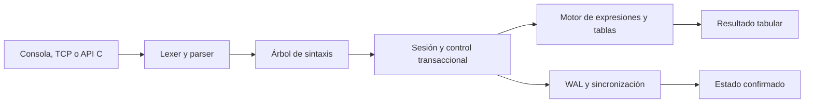

# Arquitectura y decisiones

AtlasDB separa el lenguaje SQL, la representación de los datos, la ejecución y la durabilidad. La API pública oculta las estructuras internas para poder cambiar estos componentes sin obligar al programa embebedor a conocer su disposición.

## Recorrido de una sentencia

El parser crea un AST con propiedad explícita de cadenas y valores. Un error de sintaxis libera los nodos construidos y proporciona una posición en la entrada. La profundidad de las expresiones está limitada para evitar recursión ilimitada.

El motor resuelve nombres, comprueba tipos y restricciones, evalúa expresiones y construye resultados independientes de las tablas. No expone punteros a filas que puedan invalidarse tras un commit.

## Propiedad de memoria

Una base de datos posee un estado confirmado. Este estado posee tablas; cada tabla posee sus columnas, filas e índices. Los valores de texto son cadenas con memoria propia. Las copias de estado duplican sus datos, de modo que una transacción puede descartarse sin modificar otras sesiones.

Los resultados son propiedad del llamador y se liberan mediante `adb_result_free`. Las sesiones deben destruirse antes que la base. Una sesión se utiliza desde un único hilo; varias sesiones pueden ejecutarse desde hilos diferentes.

## Transacciones e hilos

Un mutex de la base protege el estado confirmado y la publicación de commits. Una transacción explícita toma una copia de ese estado y recuerda su versión inicial. En una escritura sin `BEGIN`, el runtime construye una copia privada, ejecuta la sentencia y la publica solo si todas las fases terminan correctamente.

Dentro de una transacción, cada sentencia de escritura utiliza a su vez una copia privada. Así, una inserción de varias filas que viola una restricción no deja cambios parciales ni elimina las escrituras anteriores de la transacción.

Al confirmar una transacción con cambios, el runtime compara su versión inicial con la actual. Si difieren, devuelve un conflicto. Si coinciden, persiste la nueva versión antes de publicar el estado en memoria. El aislamiento por instantánea se consigue con copias completas y una validación de versión global; no hay un gestor de páginas con versiones por fila.

El servidor asigna un hilo y una sesión a cada conexión aceptada. Un límite de clientes acota el número de hilos. Los tiempos de espera, los límites de entrada y la salida JSON evitan depender de que un cliente siempre se comporte correctamente.

## Índices

Cada índice utiliza un árbol AVL: claves ordenadas, factores de balance y rotaciones que conservan una altura logarítmica. Una clave almacena una lista de identificadores de fila, lo que permite índices no únicos. Los índices únicos permiten varias entradas nulas; las claves primarias añaden la restricción de no nulo.

Las definiciones de índice se serializan. Sus árboles se reconstruyen al cargar o copiar tablas y después de escrituras. La selección puede buscar claves por igualdad y evaluar después la condición completa. El motor conserva identificadores estables de fila para conectar las entradas del árbol con las filas almacenadas.

## Coste y alcance

| Operación | Coste relevante |
|---|---|
| Buscar una clave AVL | O(log k), más sus coincidencias y localización de filas |
| Escanear una tabla | O(n) evaluaciones de condición |
| Crear una instantánea | Copiar todos los datos y reconstruir sus índices |
| Confirmar un cambio persistente | Serializar y escribir el estado completo |
| Reconstruir índices | Aproximadamente O(n log n) por índice |

La recuperación y la atomicidad tienen prioridad sobre el rendimiento de escritura. Un motor orientado a grandes volúmenes necesitaría páginas, un búfer de páginas, WAL incremental, índices actualizados por operación y concurrencia más fina. Estas extensiones pueden añadirse como siguientes etapas del proyecto, con cambios de formato y pruebas de fallos específicas.

## Validación

Las pruebas de API ejercitan CRUD, restricciones, valores nulos, agregados, índices, atomicidad y conflictos entre sesiones. Las de integración recorren scripts SQL, JSON, consultas contrastadas con SQLite, servidor TCP, checkpoints, colas incompletas y recuperación después de un cierre abrupto. Los sanitizadores ayudan a detectar accesos inválidos, comportamiento indefinido y fugas en esos recorridos.

El conjunto de pruebas verifica esos escenarios; no demuestra tolerancia a todos los fallos de hardware ni sustituye una auditoría de seguridad.
